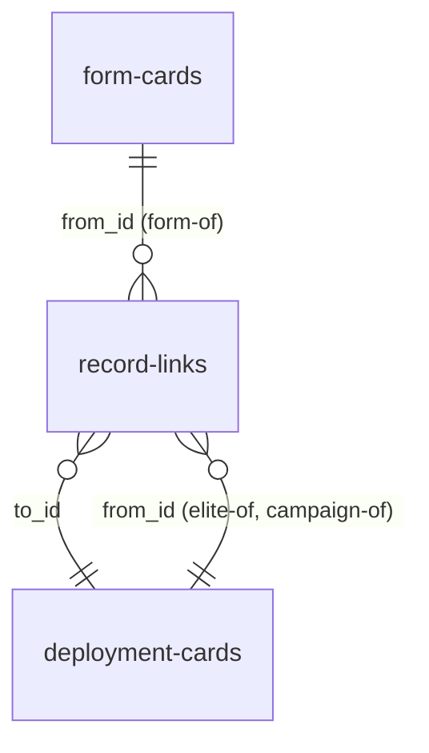
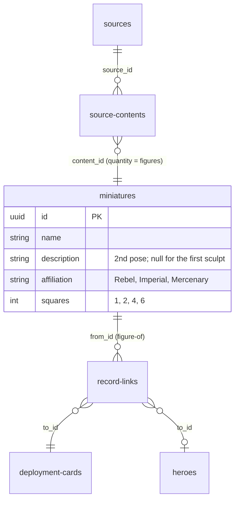
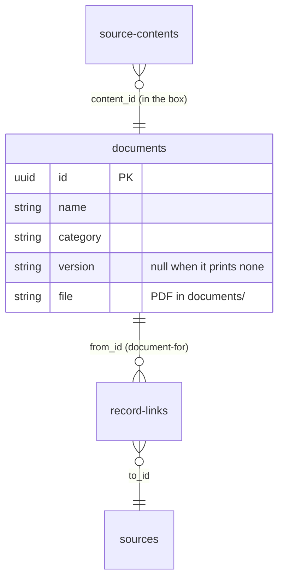
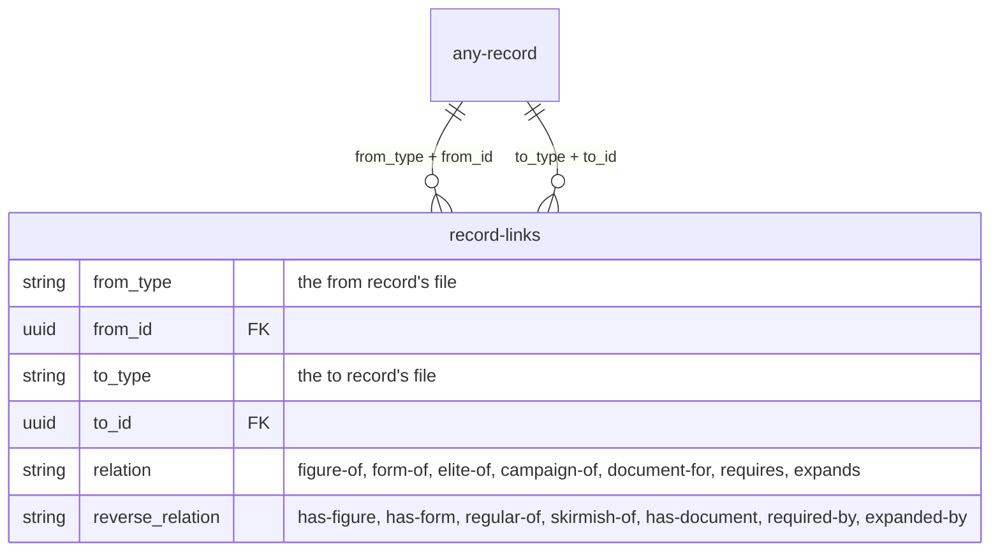
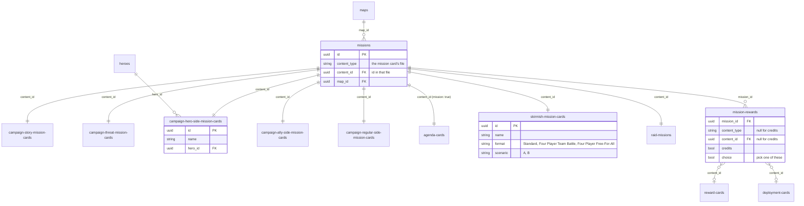
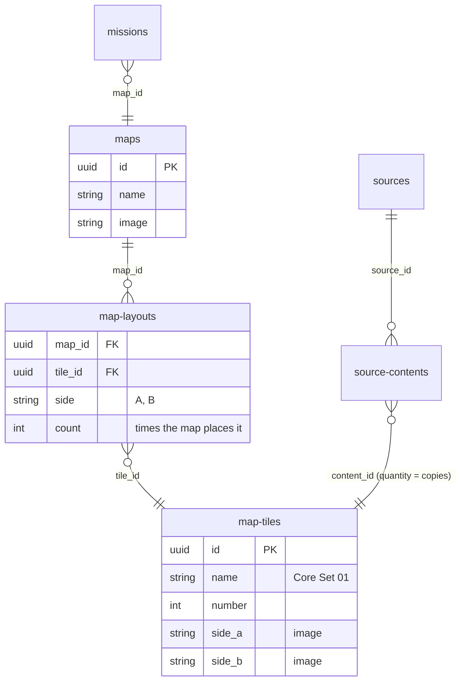
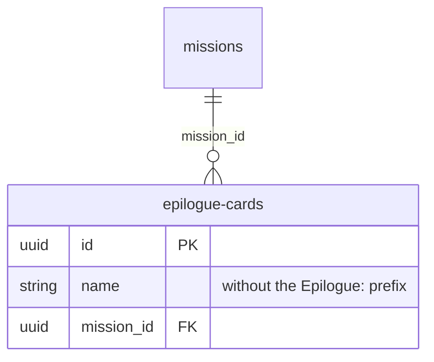

# Data model

The dataset is laid out like a relational database: each file in `data/` is a table (a JSON array of records), and
records point at each other through id fields. This page shows how the 31 files relate. Only key fields are listed;
see `schemas/` for every field.

## Ids

Every record has an `id` (all files but `source-contents`, `mission-rewards` and `record-links`), and every foreign
key holds one. Ids are lowercase UUIDs (`definitions.json#/definitions/uuid`), unique across the whole dataset:
- Records that existed in 1.x have `uuid5(NAMESPACE, "<content type>:<old numeric id>")`, where `NAMESPACE` is
  `uuid5(NAMESPACE_URL, "https://github.com/lvisintini/imperial-assault-data")`. So 1.x ids can be translated: in
  Python, `uuid.uuid5(NAMESPACE, "deployment-cards:114")` is the 1.x Stormtrooper (114). Card backs had no id; theirs
  is `uuid5(NAMESPACE, "card-backs:<1.x content type>:<1.x variant, or empty>")`.
- Records added from 2.0.0 on get a random `uuid4`.
- Ids never change once published. Records are kept in file order, not sorted by id.

The conversion is `migrations/2.0.0/01_uuid_ids.py`. It also retired 1.x deployment card 17, a duplicate "Rebel"
Bossk; the Bossk pack now lists the one (Mercenary) Bossk, card 16.

## Products and their contents

`sources` are the products (core game, expansions, ally and villain packs, skirmish map mats). `source-contents` is a join table that
maps each product to the records it contains. It is polymorphic: `content_type` names the target file and
`content_id` is the `id` of the record in it. A record can appear in more than one product (e.g. a deployment card
reprinted in a later pack). `quantity` is how many copies of it the product has: the Core Set has two of 15 command
cards, Bantha Rider two Parting Blow, each Weakened set four cards. The Core Set also has three Heroic and two
Legendary reward cards: with three heroes, each gets Heroic; with two, each gets Legendary (boardwars has neither, so
their images are the maintainer's scans). The copies come from the "(xN)" markers on the wiki's product pages, and the
Core Set's add up to FFG's component list (a test checks it).

Some products ship inside another: the Luke Skywalker Ally Pack and the Darth Vader Villain Pack come in the Core Set.
They are sources of their own, and a `source-contents` row with `content_type: "sources"` lists each one in the Core
Set. Their contents are listed on the pack, not repeated on the Core Set: everything in the Core Set box is the Core
Set's contents plus those of the packs it contains. A pack is inside one product at most, and never inside another
pack.

`maps` holds every mission's map: the two-player skirmish maps, the four-player ones (Hoth Battlefield, Nal Hutta
Borderlands, Temple Gardens) and the raid maps. Raids are played with FFG's *Legends of the Alliance* app, which is a
source of type `App`. A map is in the products its missions are in (see [Missions](#missions)), so maps have no
`source-contents` rows of their own while a mission uses them (every map, today), with one exception: FFG also sold
13 skirmish maps on their own, as neoprene mats with their own product codes (SWI38 Training Ground to SWI62 Endor
Defense Station). Each is a source of type `Skirmish Map Mat` with one `source-contents` row straight to its map, so
those maps are reached both through their missions' products and through their mat. A mat's `wave` and dates are
those the wiki's main page lists it under (waves 8 to 11), as for every other source; the mats' own wiki pages give
release dates that don't fit their waves, and aren't used. Mat images come from FFG's product pages, as the Wayback Machine archived them
(boardwars has none). Skirmish and raid map images come
from the [Skirmish Map Project](https://github.com/nickv2002/Imperial-Assault-Skirmish-Map-Project), whose half-res
files are the ones boardwars serves; campaign maps' are drawn from their tiles (see [Maps and map
tiles](#maps-and-map-tiles)).

Hero class cards, imperial class cards and agenda cards aren't linked to sources directly. They belong to a parent
record (a hero, an imperial class or an agenda deck) and come with whichever product contains that parent. Missions
are linked through the missions index (see [Missions](#missions)): `source-contents` rows with `content_type`
`missions` point at index rows.

```mermaid
erDiagram
    sources ||--|{ source-contents : "source_id"
    source-contents }o--o| sources : "content_id (a pack in a box)"

    source-contents }|--|| agenda-decks : "content_id"
    source-contents }|--|| command-cards : "content_id"
    source-contents }|--|| companion-cards : "content_id"
    source-contents }|--|| condition-cards : "content_id"
    source-contents }|--|| deployment-cards : "content_id"
    source-contents }|--|| form-cards : "content_id"
    source-contents }|--|| heroes : "content_id"
    source-contents }|--|| imperial-classes : "content_id"
    source-contents }|--|| reward-cards : "content_id"
    source-contents }|--|| maps : "content_id"
    source-contents }|--|| missions : "content_id"
    source-contents }|--|| supply-cards : "content_id"
    source-contents }|--|| upgrade-cards : "content_id"

    agenda-decks ||--|{ agenda-cards : "agenda_id"
    heroes ||--|{ hero-class-cards : "hero_id"
    imperial-classes ||--|{ imperial-class-cards : "class_id"

    sources {
        uuid id PK
        string name
        string type "Core Game, Expansion, Ally Pack, Villain Pack, App, Skirmish Map Mat, Raid Map Mat"
        string product_code "SWI##, unique"
    }
    source-contents {
        uuid source_id FK
        string content_type "target file"
        uuid content_id FK "id in that file"
        int quantity "copies in the product"
    }
    agenda-decks {
        uuid id PK
        string name
    }
    agenda-cards {
        uuid id PK
        uuid agenda_id FK
        string name
    }
    heroes {
        uuid id PK
        string name
    }
    hero-class-cards {
        uuid id PK
        uuid hero_id FK
        string name
    }
    imperial-classes {
        uuid id PK
        string name
    }
    imperial-class-cards {
        uuid id PK
        uuid class_id FK
        string name
        string type "Feat, Group Attachment"
    }
    command-cards {
        uuid id PK
        string name
        string iaspec UK
    }
    companion-cards {
        uuid id PK
        string name
        string iaspec UK
    }
    deployment-cards {
        uuid id PK
        string name
        string iaspec UK
    }
    reward-cards {
        uuid id PK
        string name
        string type "an item, Feat, Group Attachment"
        string class "Regular, Boon, Bane"
        string for "Imperial player, Rebel players"
    }
    maps {
        uuid id PK
        string name
    }
    missions {
        uuid id PK
        string content_type "the mission card's file"
    }
    supply-cards {
        uuid id PK
        string name
    }
    upgrade-cards {
        uuid id PK
        string name
    }
    condition-cards {
        uuid id PK
        string name
    }
    form-cards {
        uuid id PK
        string name
    }
```

`iaspec` is unique across deployment, command and companion cards together, not just within each file. It's the card
key of the [IA Skirmish Specification](https://github.com/kingargyle/iaskirmish-data) (MIT), the format for
exchanging skirmish lists between tools that [Tabletop Admiral](http://tabletopadmiral.com/imperialassault)
implemented (Tabletop Admiral no longer hosts Imperial Assault: the address now opens its Legion and Shatterpoint
builder). [IACP Skirmish Async](https://github.com/Mastermind1232/IACP-Skirmish-Async), a fan-made tool that plays
skirmish games with the [Imperial Assault Continuity Project](https://ia-continuityproject.com/)'s cards, keeps a copy
of the spec's `deployments.json`, but matches cards by name, not by key; the Continuity Project's own
[list builder](https://github.com/SushiCatNZ/iacp-list-builder) doesn't use the spec. Every one of the spec's 340 keys
(`tests/fixtures/iaspec-spec.json`, from its `deployments.json` and `commandcards.json`) is a card's `iaspec`, and
the cards the spec lacks (Wave 11, a few later command cards, the companions, campaign-only cards) follow its practice:
- the name, lowercased, with spaces and punctuation removed (`drivenbyhatred`);
- `elite` in front for an elite, non-unique card, but only when a regular card of the same name exists
  (`elitestormtrooper`, but `atst` and `crosstraining`);
- only while two cards would still get the same value: the game mode, which only a Campaign-only card adds, so its
  Skirmish twin keeps the spec's bare value (`agentblaise`, `agentblaisecampaign`); then the affiliation; then the
  description.

Six cards keep the spec's own spellings instead, as a key must to interoperate: `furyofkashyyk`, `sarlacsweep`,
`temporaryallianceempire`, `tempoaryalliancescum`, `lukeskywalker` and `lukeskywalkerjedi` (`TestCanonicalNames`
lists them).

Hero class, Imperial class, reward and upgrade cards have a `type`, from one list in `definitions.json` (`buff-type`)
of which each collection's schema allows its own values:
- an item's type (Armor, Equipment, Melee Weapon, Ranged Weapon and their modifications): upgrade cards, and some hero
  class and reward cards;
- Group Attachment: a card attached to an Imperial deployment group ("Attach this card to a deployment card"), among
  the Imperial class cards and the Imperial player's reward cards;
- Feat: every other hero class, Imperial class and reward card.

Whose card it is comes from its collection and, for reward cards, `for`; how its abilities are used isn't recorded
yet (#8).

Condition cards come in several products: each expansion or pack that uses a condition includes its own cards. Form
cards are the Clawdite Shapeshifter's alternative forms: each is `form-of` (in [Record links](#record-links)) both
Clawdite Shapeshifter cards, regular and elite, and its image is named after them
(`form-cards/clawdite-shapeshifter-scout.png`).

A deployment card's other versions are record links too:
- `elite-of` links an elite card to the regular card of the same name, description and affiliation whose modes overlap
  its own (Elite Stormtroopers → Stormtroopers). The Jawa Scavengers' regular card, for Campaign and Skirmish, is the
  regular of both their elite cards, one for each mode.
- `campaign-of` links a Campaign-only card to its Skirmish-only twin: same name, description, affiliation and elite
  (Agent Blaise's Campaign card → his Skirmish card). Every Campaign-only card has one. The Riot Troopers and Death
  Troopers are a square: regular and elite, each with a Campaign and a Skirmish card.

## Miniatures

`miniatures` lists every miniature sculpt: its `affiliation` and `squares`, the footprint on the map (1; 2 for 1x2,
like the E-Web Engineer; 4 for 2x2, like the Nexu; 6 for 2x3, like the AT-ST). `description` tells apart sculpts that
share a name: both Stormtrooper sculpts are "Stormtroopers", and the Stormtroopers pack's, which strike different
poses from the Core Set's, are the "2nd pose". It's null otherwise, and for the first sculpt. A file named after a
miniature (none has one yet) would combine the two into its slug: `stormtroopers`, `stormtroopers-2nd-pose`. Products list their miniatures like any other content, through `source-contents`, and `quantity` is how
many figures of it the product has (the Core Set has 9 Stormtroopers). The Core Set's Luke Skywalker and Darth Vader
are listed on their packs, which ship inside it. Miniatures have no images.

A miniature is `figure-of` (in [Record links](#record-links)) every record it stands for: the deployment cards with its
name (regular and elite, campaign and skirmish; not skirmish upgrades, which have no figure) and, for a hero, the
hero. Some miniatures stand for more than one card: General Weiss's can be set up as an AT-ST, and Captain Terro's as
a Dewback Rider. Every hero and every deployment card but the skirmish upgrades has a miniature.

The list comes from the maintainer's `migrations/2.0.0/miniatures.csv`.

## Documents

`documents` are FFG's documents for the game: `name`, `category` (Rulebook, Learn to Play, Rules Reference, Skirmish
Guide, Campaign Guide, Campaign Log, FAQ, Tournament Regulations, Organized Play, Player Sheet, Rules Sheet), `version` (as the
document prints it, the FAQ's 4 and the tournament regulations' 3.4, or as its file name gives it, Learn to Play's 17,
the Skirmish Guide's 6 and the Fundamental Event Document's 2.1; null when it has none) and `file`, the PDF in the
repository's `documents/` folder, under the file name FFG published it with. FFG never published the rules sheets: they are the
maintainer's scans, as 200 DPI PDFs named after the document (`han-solo-rules-sheet.pdf`); every ally pack, villain
pack and expansion has one. The PDFs are in the release zips but not on the explorer's site (GitHub Pages
has a size limit), which links to the repository's copy.

A document reaches products in one of two ways, or neither:
- **In the box:** the books and sheets a product ships with are its contents, `source-contents` rows like any other
  (the Core Set's Learn to Play, Rules Reference Guide and Skirmish Guide, each expansion's rulebook, and the rules
  sheets: each ally and villain pack's, and each expansion's skirmish sheet).
- **Published for it:** a document FFG published for a product, but not in its box, is `document-for` it (in
  [Record links](#record-links)): the campaign logs, the Legends of the Alliance rulebook (the app has no box), and the
  FAQ and the player sheets (squad, score and sign-up sheets), for the Core Set.
- Organized-play documents (tournament regulations, floor rules, the Fundamental Event Document, the prize tracker)
  belong to no product.

## Record links

`record-links` relates two records of any types, polymorphic at both ends: `from_type` + `from_id`, `to_type` +
`to_id`. `relation` is how the link reads from the from record, and `reverse_relation` how it reads from the to
record, so either end can show it ("Requires" on a raid, "Required by" on the product). The schema ties each relation
to its reverse and to the types it links:

| `relation`  | `reverse_relation` | from         | to                           | Meaning                                         |
|-------------|--------------------|--------------|------------------------------|-------------------------------------------------|
| `figure-of` | `has-figure`       | `miniatures` | `deployment-cards`, `heroes` | the miniature stands for the card or hero       |
| `form-of`   | `has-form`         | `form-cards` | `deployment-cards`           | the form card is a form of the deployment card  |
| `elite-of`  | `regular-of`       | `deployment-cards` | `deployment-cards`     | the elite card's regular version (shown as "Regular version" / "Elite version") |
| `campaign-of` | `skirmish-of`    | `deployment-cards` | `deployment-cards`     | the Campaign-only card's Skirmish-only twin ("Skirmish version" / "Campaign version") |
| `document-for` | `has-document`  | `documents`  | `sources`                    | the document was published for the product, not in its box |
| `requires`  | `required-by`      | any record   | `sources`                    | the record can only be played with the product (a raid needs the expansions its map is built from) |
| `expands`   | `expanded-by`      | any record   | `sources`                    | the record adds to the product (an expansion to the Core Set) |

Like `source-contents`, it has no ids, and a link is listed once. There are no `requires` or `expands` links yet.

## Missions

Every mission has a card in one of six collections:
- `campaign-story-mission-cards`, `campaign-threat-mission-cards`;
- the side missions, by color: `campaign-hero-side-mission-cards` (red; `hero_id` is the hero the mission is for),
  `campaign-ally-side-mission-cards` (green) and `campaign-regular-side-mission-cards` (grey);
- `agenda-cards` with `mission: true` (the Imperial player's agenda missions);
- `skirmish-mission-cards`: two per skirmish map, with `format` (`Standard`, `Four Player Team Battle`,
  `Four Player Free-For-All`) and `scenario` (`A` or `B`, as printed; a map's two cards are one of each). Their images are the
  wiki's (boardwars has none), at the standard size turned sideways;
- `raid-missions`: the raids of FFG's *Legends of the Alliance* app (The Malastarian Outpost, The Gray Cap Cantina),
  played on the raid maps. They're app content, with no card or image; their product is the app.

`missions` indexes them all, one row per mission card (`content_type` + `content_id`). Whether a mission is a story,
threat, side or agenda mission follows from `content_type`. The index row is what the rest of the dataset links to:
- **Products:** `source-contents` rows point at index rows (`content_type: "missions"`), never at the cards. An agenda
  mission's row lists its deck's products.
- **Map:** `map_id` is the map it's played on. Every mission has one, and a map's products are its missions' products.
  A campaign mission's map is named after it (see [Maps and map tiles](#maps-and-map-tiles)).
- **Rewards:** `mission-rewards` lists what winning gives, one row per reward, polymorphic like `source-contents`:
  `content_type` + `content_id` name a reward or deployment card, or both are null and `credits` is true. Rows with
  `choice: true` are alternatives: the player picks one (Race on Ryloth: any one Spectre ally, plus Rough Rider). An
  ally that comes as a group (Rebel Saboteurs) is its regular card; by the rules, earning the same ally again gives the
  elite card. Rewards for the Imperial player (agenda missions, `imperial_reward` on some side missions, threat
  missions' second reward) are rows like any other; the reward card's `for` says who it's for (`Imperial player`
  or `Rebel players`), and its `class` whether it's one of Return to Hoth's Boons or Banes. Story missions have no
  rows: their cards give no rewards.

The rewards come from each mission's wiki page (imperial-assault-tools' `ia wiki --missions`).

## Maps and map tiles

`maps` holds every mission's map. Skirmish, four-player and raid maps have an image (from the Skirmish Map Project).
Campaign maps, one per campaign mission and named after it, have an image drawn from their layout (see below). Five
campaign missions have no card, so no `missions` row: each campaign's introduction or finale (Aftermath, Captured,
Dark Recon, The Battle of Hoth, Trespass). Their maps are in their products directly, through `source-contents`.

Maps are built from double-sided tiles:
- `map-tiles`: a tile each, `name` ("Core Set 01", "Twin Shadows 01") and the `number` printed on it, with an image
  per side (`side_a`, `side_b`). Tiles reach their products through `source-contents`, with `quantity` = how many of
  that tile the box has.
- `map-layouts` (no ids): the tile sides a map uses, `{map_id, tile_id, side, count}`, `count` being how many times
  the map places that side. Some campaign maps are built from sections that replace each other during the mission
  (Heart of the Empire's Into a Corner), so a count can be more than a box's copies.

So every mission reaches its tiles the same way: mission → map → map layouts → map tiles → products.

A tile's images are cut on its outline: the connector tabs are kept and the notches are transparent, so tiles placed
side by side fit as on the table. They're 64 px per square, plus 32 px on each axis that has tabs, and the small
image is the same file as the large one. They come from the Vassal *Imperial Assault Campaign Module* (1.14). The
campaign maps' layouts come from [ImperialCommander2](https://github.com/GlowPuff/ImperialCommander2), summed over
each mission's map sections; the skirmish and raid maps' were entered by the maintainer from their maps (`ia enter`'s
Map layouts page). Every map has a layout.

The campaign maps' images are drawn by imperial-assault-tools' `ia maps`: each tile side placed where
ImperialCommander2's mission file puts it, at 64 px per square, on a transparent background. They show the tiles only
(no doors, tokens or figures). A map whose sections replace each other during the mission (Into a Corner, Preventative
Measures, Trespass, Dangerous Allies, Call to Action, The Final Order, Salvage Operatives) shows its start section;
the others show every section. Like the tiles, a campaign map's small image is the same file as its large one.

## Epilogues

`epilogue-cards` are the cards a campaign mission can end on, two per mission: the Wave 11 packs each have one mission
(an agenda or ally side mission) whose outcome picks one of its two epilogues. `mission_id` is that mission's
`missions` row, so an epilogue reaches its product through its mission and has no `source-contents` rows. Each
mission's epilogues have their own back ("Executive Overreach Epilogues").

Boardwars has none of them: their images come from the Tabletop Simulator save linked on #15, and the pairing of names
to missions from the wiki's pack pages.

## Card backs

`card-backs` is a catalog of the backs printed on the cards: `name` and `image`. Every card points at its back
through `back_id`, so finding a card's back takes no rules. A back's `name` is its deck, and which of the deck's backs
it is when there are several: "Deployment: Rebel", "Rebel Hero: Biv Bodhrik", "Story Mission: Return to Hoth". A
back's image has the size of the cards that use it.

Some backs belong to a deck rather than to one card, and are printed on all of its cards: each hero's back (on its
class cards), each Imperial class's back (on its class cards) and the agenda back (on the agenda cards). The cards
carry `back_id`; heroes, `imperial-classes` and `agenda-decks` don't, and a parent's cards all share one back. One
back can serve several content types: "Side Mission" is the back of all three side mission collections.

`sources`, `maps` and `heroes` (hero sheets are two-sided) have no back, and `missions`, `mission-rewards`,
`source-contents` and `record-links` are indexes and join tables, not cards. The skirmish mission back is a scan by
the maintainer; the others come from boardwars, except the epilogue backs (with their cards, from the Tabletop
Simulator save).

```mermaid
erDiagram
    card-backs ||--|{ agenda-cards : "back_id"
    card-backs ||--|{ command-cards : "back_id"
    card-backs ||--|{ companion-cards : "back_id"
    card-backs ||--|{ condition-cards : "back_id"
    card-backs ||--|{ deployment-cards : "back_id"
    card-backs ||--|{ epilogue-cards : "back_id"
    card-backs ||--|{ form-cards : "back_id"
    card-backs ||--|{ hero-class-cards : "back_id"
    card-backs ||--|{ imperial-class-cards : "back_id"
    card-backs ||--|{ reward-cards : "back_id"
    card-backs ||--|{ supply-cards : "back_id"
    card-backs ||--|{ upgrade-cards : "back_id"
    card-backs ||--|{ campaign-story-mission-cards : "back_id"
    card-backs ||--|{ campaign-threat-mission-cards : "back_id"
    card-backs ||--|{ campaign-hero-side-mission-cards : "back_id"
    card-backs ||--|{ campaign-ally-side-mission-cards : "back_id"
    card-backs ||--|{ campaign-regular-side-mission-cards : "back_id"
    card-backs ||--|{ skirmish-mission-cards : "back_id"

    card-backs {
        uuid id PK
        string name "deck, and which back of it"
    }
```

Until 2.0.0, backs were matched to cards by `content_type` and a `variant` that matched a different field per type
(an affiliation, a name, a tier, a product's name). `migrations/2.0.0/09_card_backs.py` applied those rules once to
fill in `back_id`.
