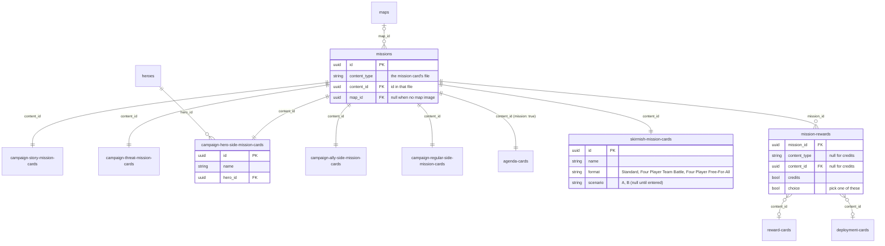

# Data model

The dataset is laid out like a relational database: each file in `data/` is a table (a JSON array of records), and
records point at each other through id fields. This page shows how the 26 files relate. Only key fields are listed;
see `schemas/` for every field.

## Ids

Every record has an `id` (all files but `source-contents` and `mission-rewards`), and every foreign key holds one. Ids are lowercase
UUIDs (`definitions.json#/definitions/uuid`), unique across the whole dataset:
- Records that existed in 1.x have `uuid5(NAMESPACE, "<content type>:<old numeric id>")`, where `NAMESPACE` is
  `uuid5(NAMESPACE_URL, "https://github.com/lvisintini/imperial-assault-data")`. So 1.x ids can be translated: in
  Python, `uuid.uuid5(NAMESPACE, "deployment-cards:114")` is the 1.x Stormtrooper (114). Card backs had no id; theirs
  is `uuid5(NAMESPACE, "card-backs:<content type>:<variant, or empty>")`.
- Records added from 2.0.0 on get a random `uuid4`.
- Ids never change once published. Records are kept in file order, not sorted by id.

The conversion is `migrations/2.0.0/01_uuid_ids.py`. It also retired 1.x deployment card 17, a duplicate "Rebel"
Bossk; the Bossk pack now lists the one (Mercenary) Bossk, card 16.

## Products and their contents

`sources` are the products (core game, expansions, ally and villain packs). `source-contents` is a join table that
maps each product to the records it contains. It is polymorphic: `content_type` names the target file and
`content_id` is the `id` of the record in it. A record can appear in more than one product (e.g. a deployment card
reprinted in a later pack).

Some products ship inside another: the Luke Skywalker Ally Pack and the Darth Vader Villain Pack come in the Core Set.
They are sources of their own with `included_in` set to the Core Set, and their contents are listed on the pack, not
repeated on the Core Set. Everything in the Core Set box is the Core Set's contents plus those of the sources it
includes.

`maps` holds every mission's map: the two-player skirmish maps, the four-player ones (Hoth Battlefield, Nal Hutta
Borderlands, Temple Gardens) and the raid maps. Raids are played with FFG's *Legends of the Alliance* app, which is a
source of type `App`. A map is in the products its missions are in (see [Missions](#missions)); only maps no
mission uses yet (the raid maps, for now) have `source-contents` rows of their own. Map images come from the
[Skirmish Map Project](https://github.com/nickv2002/Imperial-Assault-Skirmish-Map-Project), whose half-res files are
the ones boardwars serves.

Hero class cards, imperial class cards and agenda cards aren't linked to sources directly. They belong to a parent
record (a hero, an imperial class or an agenda deck) and come with whichever product contains that parent. Missions
are linked through the missions index (see [Missions](#missions)): `source-contents` rows with `content_type`
`missions` point at index rows.

```mermaid
erDiagram
    sources ||--|{ source-contents : "source_id"
    sources |o--o{ sources : "included_in"

    source-contents }|--|| agenda-decks : "content_id"
    source-contents }|--|| command-cards : "content_id"
    source-contents }|--|| companion-cards : "content_id"
    source-contents }|--|| condition-cards : "content_id"
    source-contents }|--|| deployment-cards : "content_id"
    source-contents }|--|| form-cards : "content_id"
    source-contents }|--|| heroes : "content_id"
    source-contents }|--|| imperial-classes : "content_id"
    source-contents }|--|| reward-cards : "content_id"
    source-contents }|--|| maps : "content_id"
    source-contents }|--|| missions : "content_id"
    source-contents }|--|| supply-cards : "content_id"
    source-contents }|--|| upgrade-cards : "content_id"

    agenda-decks ||--|{ agenda-cards : "agenda_id"
    heroes ||--|{ hero-class-cards : "hero_id"
    imperial-classes ||--|{ imperial-class-cards : "class_id"

    sources {
        uuid id PK
        string name
        string type "Core Game, Expansion, Ally Pack, Villain Pack, App"
        string product_code "SWI##, unique"
        uuid included_in FK "the source it ships inside"
    }
    source-contents {
        uuid source_id FK
        string content_type "target file"
        uuid content_id FK "id in that file"
    }
    agenda-decks {
        uuid id PK
        string name
    }
    agenda-cards {
        uuid id PK
        uuid agenda_id FK
        string name
    }
    heroes {
        uuid id PK
        string name
    }
    hero-class-cards {
        uuid id PK
        uuid hero_id FK
        string name
    }
    imperial-classes {
        uuid id PK
        string name
    }
    imperial-class-cards {
        uuid id PK
        uuid class_id FK
        string name
    }
    command-cards {
        uuid id PK
        string name
        string iaspec UK
    }
    companion-cards {
        uuid id PK
        string name
        string iaspec UK
    }
    deployment-cards {
        uuid id PK
        string name
        string iaspec UK
    }
    reward-cards {
        uuid id PK
        string name
    }
    maps {
        uuid id PK
        string name
    }
    missions {
        uuid id PK
        string content_type "the mission card's file"
    }
    supply-cards {
        uuid id PK
        string name
    }
    upgrade-cards {
        uuid id PK
        string name
    }
    condition-cards {
        uuid id PK
        string name
    }
    form-cards {
        uuid id PK
        string name
    }
```

`iaspec` is unique across deployment, command and companion cards together, not just within each file.
It's built from the card: `elite` for elite, non-unique cards, then the name, lowercased with spaces and punctuation
removed (`elitecrosstraining`). Only when two cards would get the same value does it add the game mode (when the card
has only one), then the affiliation, then the description.

Condition cards come in several products: each expansion or pack that uses a condition includes its own cards. Form
cards are the Clawdite Shapeshifter's alternative forms. A link from them to their deployment card is planned in
[#3](https://github.com/lvisintini/imperial-assault-data/issues/3).

## Missions

Every mission has a card in one of six collections:
- `campaign-story-mission-cards`, `campaign-threat-mission-cards`;
- the side missions, by color: `campaign-hero-side-mission-cards` (red; `hero_id` is the hero the mission is for),
  `campaign-ally-side-mission-cards` (green) and `campaign-regular-side-mission-cards` (grey);
- `agenda-cards` with `mission: true` (the Imperial player's agenda missions);
- `skirmish-mission-cards`: two per skirmish map, with `format` (`Standard`, `Four Player Team Battle`,
  `Four Player Free-For-All`) and `scenario` (`A` or `B`, as printed; null until entered). Their images are the
  wiki's, the one image source besides boardwars for cards, at the standard size turned sideways.

`missions` indexes them all, one row per mission card (`content_type` + `content_id`). Whether a mission is a story,
threat, side or agenda mission follows from `content_type`. The index row is what the rest of the dataset links to:
- **Products:** `source-contents` rows point at index rows (`content_type: "missions"`), never at the cards. An agenda
  mission's row lists its deck's products.
- **Map:** `map_id` is the map it's played on, or null while the dataset has no image of it (every campaign map, for
  now). Every skirmish mission has one, and a map's products are its missions' products.
- **Rewards:** `mission-rewards` lists what winning gives, one row per reward, polymorphic like `source-contents`:
  `content_type` + `content_id` name a reward or deployment card, or both are null and `credits` is true. Rows with
  `choice: true` are alternatives: the player picks one (Race on Ryloth: any one Spectre ally, plus Rough Rider). An
  ally that comes as a group (Rebel Saboteurs) is its regular card; by the rules, earning the same ally again gives the
  elite card. Rewards for the Imperial player (agenda missions, `imperial_reward` on some side missions, threat
  missions' second reward) are rows like any other; the reward card says who it's for. Story mission rewards aren't
  loaded yet.

The rewards come from each mission's wiki page (imperial-assault-tools' `ia wiki --missions`).

## Card backs

Each `card-backs` record is the back of one deck and points at a content type through `content_type`. It has an
`id`, though nothing references it yet (#52 will replace the matching rules below with a `back_id` on each card).
When a content type has several backs, `variant` says which records a back belongs to, and it matches a different
field in each content type:

| `content_type`         | `variant` | Back belongs to the records where                                        |
|------------------------|-----------|--------------------------------------------------------------------------|
| `deployment-cards`     | set       | `affiliation` = `variant`                                                |
| `heroes`               | set       | `name` = `variant`                                                       |
| `imperial-classes`     | set       | `name` = `variant`                                                       |
| `condition-cards`      | set       | `name` = `variant`                                                       |
| `upgrade-cards`        | set       | `"Tier " + tier` = `variant`                                             |
| `campaign-story-mission-cards`  | set | the mission is in the source whose `name` = `variant` (via its missions row) |
| `campaign-threat-mission-cards` | set | the mission is in the source whose `name` = `variant` (via its missions row) |
| `form-cards`           | `Clawdite`| every record (all form cards share one back)                              |
| any other type         | `null`    | every record of that type                                                |

Some backs are keyed on a parent record but are printed on its child cards: the `heroes` backs (deck "Rebel Hero")
are on each hero's class cards, the `imperial-classes` backs on that class's cards, and the `agenda-decks` back on
the agenda cards. To find a child card's back, go through its parent.

```mermaid
erDiagram
    card-backs ||--|{ deployment-cards : "variant = affiliation"
    card-backs ||--|{ heroes : "variant = name"
    card-backs ||--|{ imperial-classes : "variant = name"
    card-backs ||--|{ condition-cards : "variant = name"
    card-backs ||--|{ upgrade-cards : "variant = Tier + tier"
    card-backs ||--|{ campaign-story-mission-cards : "variant = source name"
    card-backs ||--|{ campaign-threat-mission-cards : "variant = source name"
    card-backs ||--|{ form-cards : "one back"
    card-backs ||--|{ agenda-decks : "one back"
    card-backs ||--|{ command-cards : "one back"
    card-backs ||--|{ companion-cards : "one back"
    card-backs ||--|{ reward-cards : "one back"
    card-backs ||--|{ campaign-hero-side-mission-cards : "one back"
    card-backs ||--|{ campaign-ally-side-mission-cards : "one back"
    card-backs ||--|{ campaign-regular-side-mission-cards : "one back"
    card-backs ||--|{ supply-cards : "one back"

    card-backs {
        uuid id PK
        string deck "deck name shown on the back"
        string content_type "target file"
        string variant "null when the type has one back"
    }
    deployment-cards {
        string affiliation "Imperial, Mercenary, Neutral, Rebel"
    }
    upgrade-cards {
        int tier "1, 2, 3"
    }
```

`sources`, `maps` and `skirmish-mission-cards` have no card back (the dataset has no skirmish mission back yet). The three side mission collections share one back image, listed once per
collection (until #52 makes card backs a catalog). `missions` and `mission-rewards` are indexes, not cards.
