# Data model

The dataset is laid out like a relational database: each file in `data/` is a table (a JSON array of records), and
records point at each other through id fields. This page shows how the 21 files relate. Only key fields are listed;
see `schemas/` for every field.

## Products and their contents

`sources` are the products (core game, expansions, ally and villain packs). `source-contents` is a join table that
maps each product to the records it contains. It is polymorphic: `content_type` names the target file and
`content_id` is the `id` of the record in it. A record can appear in more than one product (e.g. a deployment card
reprinted in a later pack).

Hero class cards, imperial class cards and agenda cards aren't linked to sources directly. They belong to a parent
record (a hero, an imperial class or an agenda deck) and come with whichever product contains that parent.

```mermaid
erDiagram
    sources ||--|{ source-contents : "source_id"

    source-contents }|--|| agenda-decks : "content_id"
    source-contents }|--|| command-cards : "content_id"
    source-contents }|--|| companion-cards : "content_id"
    source-contents }|--|| deployment-cards : "content_id"
    source-contents }|--|| heroes : "content_id"
    source-contents }|--|| imperial-classes : "content_id"
    source-contents }|--|| reward-cards : "content_id"
    source-contents }|--|| side-mission-cards : "content_id"
    source-contents }|--|| skirmish-maps : "content_id"
    source-contents }|--|| story-mission-cards : "content_id"
    source-contents }|--|| supply-cards : "content_id"
    source-contents }|--|| threat-mission-cards : "content_id"
    source-contents }|--|| upgrade-cards : "content_id"

    agenda-decks ||--|{ agenda-cards : "agenda_id"
    heroes ||--|{ hero-class-cards : "hero_id"
    imperial-classes ||--|{ imperial-class-cards : "class_id"

    sources {
        int id PK
        string name
        string type "Core Game, Expansion, Ally Pack, Villain Pack"
    }
    source-contents {
        int source_id FK
        string content_type "target file"
        int content_id FK "id in that file"
    }
    agenda-decks {
        int id PK
        string name
    }
    agenda-cards {
        int id PK
        int agenda_id FK
        string name
    }
    heroes {
        int id PK
        string name
    }
    hero-class-cards {
        int id PK
        int hero_id FK
        string name
    }
    imperial-classes {
        int id PK
        string name
    }
    imperial-class-cards {
        int id PK
        int class_id FK
        string name
    }
    command-cards {
        int id PK
        string name
        string iaspec UK
    }
    companion-cards {
        int id PK
        string name
        string iaspec UK
    }
    deployment-cards {
        int id PK
        string name
        string iaspec UK
    }
    reward-cards {
        int id PK
        string name
    }
    side-mission-cards {
        int id PK
        string name
    }
    skirmish-maps {
        int id PK
        string name
    }
    story-mission-cards {
        int id PK
        string name
    }
    supply-cards {
        int id PK
        string name
    }
    threat-mission-cards {
        int id PK
        string name
    }
    upgrade-cards {
        int id PK
        string name
    }
    condition-cards {
        string name PK
    }
    form-cards {
        int id PK
        string name
    }
```

`iaspec` is unique across deployment, command and companion cards together, not just within each file.
It's built from the card: `elite` for elite, non-unique cards, then the name, lowercased with spaces and punctuation
removed (`elitecrosstraining`). Only when two cards would get the same value does it add the game mode (when the card
has only one), then the affiliation, then the description.

### Not linked to any product yet

- `condition-cards` (keyed by `name`, no `id`) and `form-cards` aren't referenced by `source-contents`, so you can't
  tell which product they come from.
- Form cards are the Clawdite Shapeshifter's alternative forms. A link from them to their deployment card is planned
  in [#3](https://github.com/lvisintini/imperial-assault-data/issues/3).

## Card backs

`card-backs` has no `id`. Each record is the back of one deck and points at a content type through `content_type`.
When a content type has several backs, `variant` says which records a back belongs to, and it matches a different
field in each content type:

| `content_type`         | `variant` | Back belongs to the records where                                        |
|------------------------|-----------|--------------------------------------------------------------------------|
| `deployment-cards`     | set       | `affiliation` = `variant`                                                |
| `heroes`               | set       | `name` = `variant`                                                       |
| `imperial-classes`     | set       | `name` = `variant`                                                       |
| `condition-cards`      | set       | `name` = `variant`                                                       |
| `upgrade-cards`        | set       | `"Tier " + tier` = `variant`                                             |
| `story-mission-cards`  | set       | the record is in the source whose `name` = `variant` (via source-contents) |
| `threat-mission-cards` | set       | the record is in the source whose `name` = `variant` (via source-contents) |
| `form-cards`           | `Clawdite`| every record (all form cards share one back)                              |
| any other type         | `null`    | every record of that type                                                |

Some backs are keyed on a parent record but are printed on its child cards: the `heroes` backs (deck "Rebel Hero")
are on each hero's class cards, the `imperial-classes` backs on that class's cards, and the `agenda-decks` back on
the agenda cards. To find a child card's back, go through its parent.

```mermaid
erDiagram
    card-backs ||--|{ deployment-cards : "variant = affiliation"
    card-backs ||--|{ heroes : "variant = name"
    card-backs ||--|{ imperial-classes : "variant = name"
    card-backs ||--|{ condition-cards : "variant = name"
    card-backs ||--|{ upgrade-cards : "variant = Tier + tier"
    card-backs ||--|{ story-mission-cards : "variant = source name"
    card-backs ||--|{ threat-mission-cards : "variant = source name"
    card-backs ||--|{ form-cards : "one back"
    card-backs ||--|{ agenda-decks : "one back"
    card-backs ||--|{ command-cards : "one back"
    card-backs ||--|{ companion-cards : "one back"
    card-backs ||--|{ reward-cards : "one back"
    card-backs ||--|{ side-mission-cards : "one back"
    card-backs ||--|{ supply-cards : "one back"

    card-backs {
        string deck "deck name shown on the back"
        string content_type "target file"
        string variant "null when the type has one back"
    }
    deployment-cards {
        string affiliation "Imperial, Mercenary, Neutral, Rebel"
    }
    upgrade-cards {
        int tier "1, 2, 3"
    }
```

`sources` and `skirmish-maps` have no card back.
